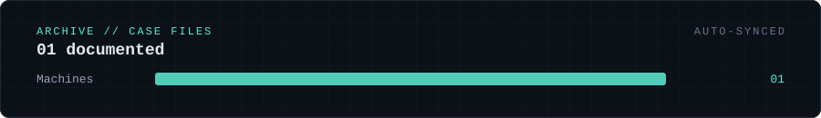

<p align="center">
  
</p>

<p align="center">
  
  
  
</p>

<p align="center">
  
  
  
  
</p>

---

### `$ whoami`

<p align="center">
  
  
  
  
</p>

```text
handle   : DAMNZ
role     : offensive operator · software engineer
focus    : Active Directory · Linux · web exploitation on Hack The Box
builds   : MCP servers · multi-agent pipelines · bare-metal firmware
signal   : SDR analysis · microwave dish alignment (Ku / C) · 2.4 GHz telemetry
```

Self-taught operator. I break enterprise-style networks in the lab, then write up the
*why* — architecture, protocol seams and mitigations — never the keys.

---

### `$ cat rank.txt`

<p align="center">
  <a href="https://app.hackthebox.com/users/3419151">
    
  </a>
</p>

---

### `$ ls ~/repos --featured`

| Repo | What it is | Stack |
|:-----|:-----------|:------|
| [**writeups**](https://github.com/damnz-dev/writeups) | Sanitized case studies of lab attack chains: architecture, protocol analysis and defensive mitigations. No flags, no credentials, no step-by-step. |    |
| [**damnz-dev.github.io**](https://github.com/damnz-dev/damnz-dev.github.io) | Bilingual (ES/EN) static CV in terminal style, strict CSP, zero JS frameworks; daily HTB sync via GitHub Actions. |    |

---

### `$ cat writeups/INDEX`

<p align="center">
  <a href="https://github.com/damnz-dev/writeups">
    
  </a>
</p>

<!-- WRITEUPS:START -->
| # | Case | Category | Difficulty | Link |
|:-:|:-----|:--------:|:----------:|:----:|
| `01` | **Autopilot**<br><sub>Protocol Breakdown & Hybrid Cross-Relay Analysis</sub> |  |  | [`↗`](https://github.com/damnz-dev/writeups/blob/main/machines/autopilot.md) |
<!-- WRITEUPS:END -->

<p align="center"><sub>Auto-synced from <a href="https://github.com/damnz-dev/writeups">damnz-dev/writeups</a> · full table, category folders &amp; template inside.</sub></p>

---

### `$ cat stack.txt`

<p align="center"><sub><b>LANGUAGES</b></sub></p>
<p align="center">
  
  
  
  
  
</p>

<p align="center"><sub><b>OFFENSIVE SURFACE</b></sub></p>
<p align="center">
  
  
  
  
</p>

<p align="center"><sub><b>TOOLING &amp; PLATFORMS</b></sub></p>
<p align="center">
  
  
  
  
  
  
</p>

---

### `$ cat contact`

<p align="center">
  <a href="https://github.com/damnz-dev"></a>
</p>

<p align="center">
  
</p>

<p align="center"><sub>— <i>DAMNZ</i> · <code>● CLEARANCE: PUBLIC</code></sub></p>
